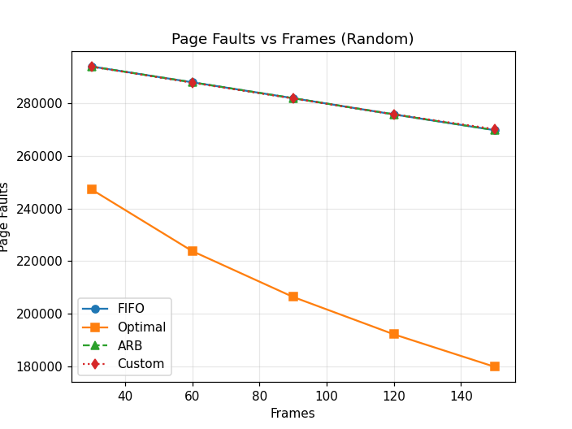
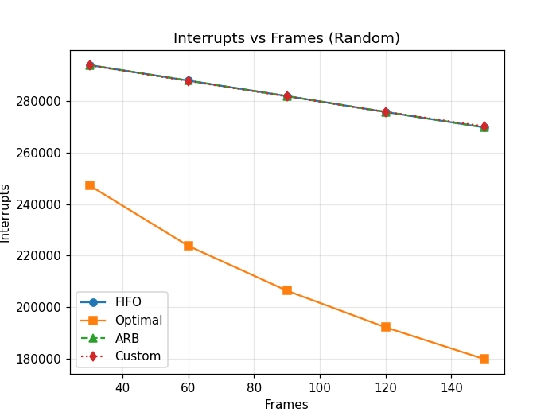
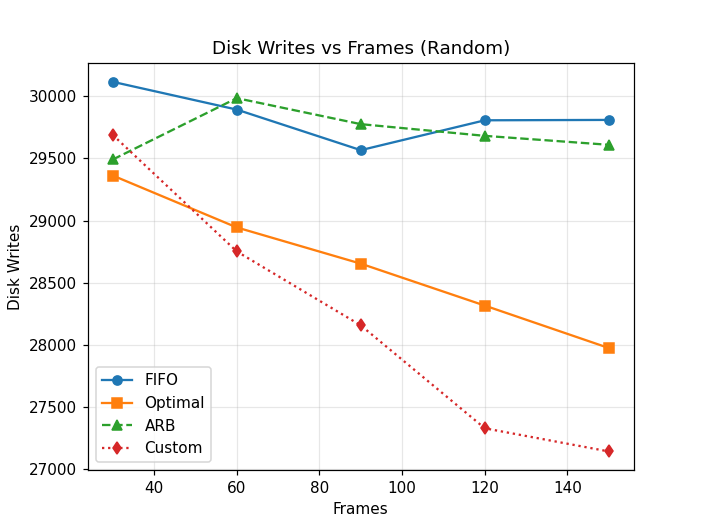
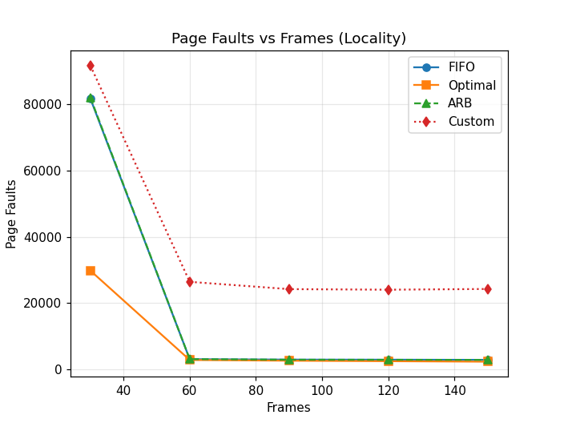
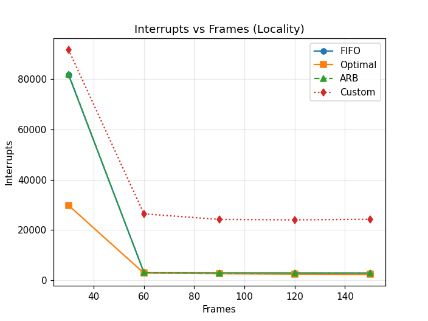
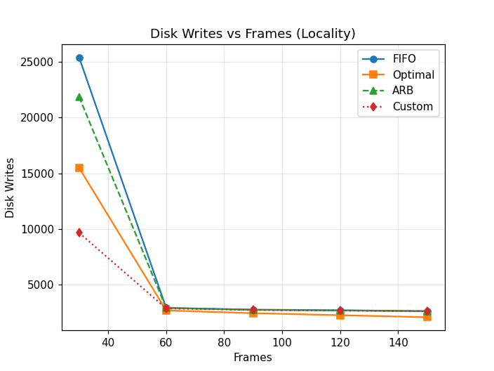
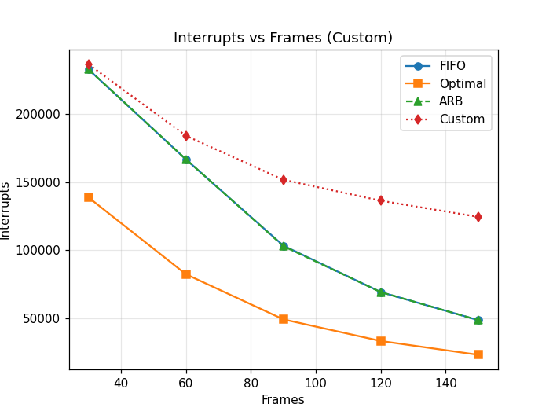
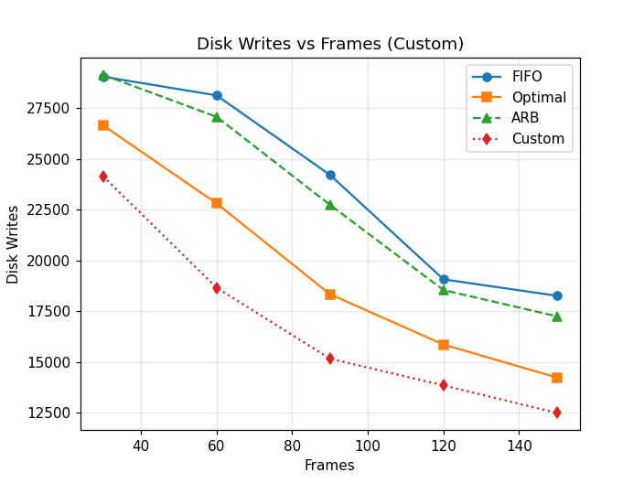

# Page Replacement Algorithms Simulator

以 Python 模擬並比較四種分頁置換演算法：FIFO、Optimal、Additional Reference Bits（ARB），以及自行設計的 Dirty-Aware ARB。每種演算法在三種存取模式、五種 frame 數量下執行，統計 page fault、interrupt 與 disk write 三項指標。

## 實驗設定

| 項目 | 設定 |
|---|---|
| Page 編號範圍 | 1–1500 |
| 記憶體存取次數 | 300,000 次 |
| Frame 數量 | 30、60、90、120、150 |
| 寫入比例 | 每次存取有 10% 機率為寫入（設定 dirty bit） |

**成本模型：**

- **Interrupt：** 每次 page fault 都要呼叫 OS 處理，計為 1 次 interrupt。
- **Disk write：** 被置換出去的 page 若為 dirty，需要寫回磁碟，計為 1 次 disk write。
- **總成本** = interrupts + disk writes。

## 存取模式（Reference String）

| 模式 | 產生方式 | 模擬情境 |
|---|---|---|
| Random | 每次從 1–1500 均勻隨機選一個 page | 沒有任何區域性的程式 |
| Locality | 隨機選一個起點，接下來 4,000 次存取都落在連續 41 個 page 內，再換下一個區段 | 程序呼叫：一段時間內只使用一小塊連續記憶體 |
| Custom | 每 5,000 次存取為一個週期：前 2,500 次在 page 1–100，後 2,500 次在 page 1000–1200 | 週期性在兩個工作集之間切換，例如程式交替執行兩個階段 |

自訂的 Custom 模式用來觀察：當工作集突然切換，而舊工作集的 page 還留在記憶體中時，各演算法能多快把記憶體讓給新的工作集。

## 演算法

### FIFO

用 queue 記錄 page 進入記憶體的順序，置換時移除最早進入的 page。

### Optimal

預先掃描整個 reference string，為每個 page 建立一個「未來存取位置」的 deque。置換時選擇下一次使用位置最遠、或之後不會再被使用的 page。實際系統無法得知未來的存取，因此 Optimal 只作為理論下界。

### Additional Reference Bits（ARB）

每個 page 維護一個 8-bit 的歷史暫存器：

- 被存取時，把最高位元設為 1（`|= 0b10000000`）。
- 每 100 次存取，所有 page 的暫存器右移 1 位，讓舊的存取紀錄逐漸衰減。
- 置換時選擇暫存器數值最小的 page，也就是最近最少被使用的 page。

### Custom：Dirty-Aware ARB

以 ARB 為基礎，加入 dirty bit 的考量。置換時先只在 clean page 中挑選 ARB 數值最小者；只有在記憶體中全是 dirty page 時，才從全部 page 中挑選並寫回磁碟。設計目標是用較少的磁碟寫回降低 I/O 成本。

## 目錄結構

```
page-replacement-sim/
├── algorithms.py     # FIFO、Optimal、ARB、Custom 四種演算法
├── generator.py      # Random、Locality、Custom 三種 reference string
├── simulation.py     # 執行所有組合並繪製圖表
└── results/          # 9 張結果圖（3 種模式 × 3 項指標）
```

## 執行方式

```bash
pip install matplotlib
python simulation.py
```

完整執行約需 1–2 分鐘，會在目前目錄輸出 9 張圖，例如 `Page Faults_Random.png`。

## 實驗結果

以下數據為一次完整執行的結果（`random.seed(2025)`）。由於存取序列與寫入都是隨機產生，每次執行的數字會略有不同，但趨勢一致。

### Page Faults

| 模式 | Frames | FIFO | Optimal | ARB | Custom |
|---|---|---|---|---|---|
| Random | 30 | 294,021 | 247,236 | 294,009 | 293,935 |
| Random | 150 | 269,804 | 179,820 | 269,835 | 270,185 |
| Locality | 30 | 81,766 | 29,767 | 82,068 | 91,730 |
| Locality | 60 | 3,003 | 2,770 | 3,016 | 26,381 |
| Locality | 150 | 2,800 | 2,255 | 2,793 | 24,223 |
| Custom | 30 | 233,000 | 138,831 | 233,080 | 236,786 |
| Custom | 150 | 48,650 | 23,142 | 48,671 | 124,623 |

### Disk Writes

| 模式 | Frames | FIFO | Optimal | ARB | Custom |
|---|---|---|---|---|---|
| Random | 30 | 30,115 | 29,362 | 29,491 | 29,688 |
| Random | 150 | 29,809 | 27,976 | 29,609 | 27,145 |
| Locality | 30 | 25,372 | 15,481 | 21,844 | 9,664 |
| Locality | 150 | 2,650 | 2,105 | 2,643 | 2,630 |
| Custom | 30 | 29,038 | 26,642 | 29,128 | 24,138 |
| Custom | 150 | 18,266 | 14,245 | 17,255 | 12,501 |

### 總成本（Interrupts + Disk Writes）

| 模式 | Frames | FIFO | Optimal | ARB | Custom |
|---|---|---|---|---|---|
| Random | 30 | 324,136 | 276,598 | 323,500 | 323,623 |
| Random | 150 | 299,613 | 207,796 | 299,444 | 297,330 |
| Locality | 30 | 107,138 | 45,248 | 103,912 | 101,394 |
| Locality | 60 | 5,946 | 5,480 | 5,943 | 29,270 |
| Custom | 30 | 262,038 | 165,473 | 262,208 | 260,924 |
| Custom | 150 | 66,916 | 37,387 | 65,926 | 137,124 |

### 圖表

| | Page Faults | Interrupts | Disk Writes |
|---|---|---|---|
| Random |  |  |  |
| Locality |  |  |  |
| Custom |  |  |  |

## 分析

**Optimal 在所有情境下都是最低的。** 這符合預期，它是理論下界。在 Locality 模式、30 frames 時，Optimal 的 page fault 只有 FIFO 的約 36%；frames 增加到 60 之後，所有演算法都能容納 41 個 page 的工作集，差距就幾乎消失。

**Random 模式下，三種實際可用的演算法幾乎沒有差別。** 存取沒有區域性，任何依據「過去」做的判斷都無法預測未來，因此 FIFO、ARB、Custom 的 page fault 相差不到 0.2%。Page fault 隨 frame 數大致線性下降，近似「命中率 ≈ frames / 1500」。

**ARB 的表現幾乎與 FIFO 相同。** 原因很可能是 reference bits 的解析度太粗：每 100 次存取才右移一次，許多 page 的暫存器數值相同；遇到相同數值時，`min()` 會選到記憶體串列中最前面、也就是最早進入的 page，等於退化成 FIFO。縮短右移的間隔、或以 LRU 作為 tie-breaker，應該能拉開差距。

**Custom 確實降低了 disk writes，但 page fault 大幅增加，總成本反而變高。** 在 Locality 模式、30 frames 時，Custom 的 disk writes 只有 FIFO 的 38%，總成本也略低於 FIFO；但只要 frames ≥ 60，Custom 的 page fault 就是其他演算法的 8–9 倍。

原因是 dirty page 會被永久保留。Custom 只要記憶體中還有 clean page 就不會置換 dirty page，而 dirty page 沒有被寫回，dirty bit 也就不會被清除。隨著時間推移，舊工作集中被寫過的 page 會不斷累積。實際追蹤 Locality 模式、60 frames 的執行過程，從第 20,000 次存取開始，記憶體中就有 59 個 frame 被 dirty page 佔住，所有新進的 page 只能輪流使用剩下的 1 個 frame，形成嚴重的 thrashing。

**可行的改進方向：**

- **把 dirty 當成權重，而不是絕對優先。** 例如參考 Enhanced Second-Chance 演算法，依 (reference, dirty) 分成四個等級；或者只在 ARB 數值相近的候選 page 中優先選 clean page。
- **限制 dirty page 的比例。** 當 dirty page 超過一定比例時，主動把最久沒用到的 dirty page 寫回並清除 dirty bit。
- **允許「夠老」的 dirty page 被置換。** ARB 數值為 0 的 page 代表已經 800 次存取以上沒被用到，即使是 dirty 也應該讓出位置。

## 已知問題

- **Interrupt 與 page fault 完全相同。** 程式只在 page fault 時增加 interrupt，因此兩張圖一模一樣。若把 dirty page 寫回磁碟也視為一次需要 OS 介入的 I/O，interrupt 應該再加上 disk write 的次數。
- **結果無法重現。** 程式沒有設定 random seed，而且每個演算法執行時都重新抽一次「是否寫入」，所以不同演算法看到的寫入序列其實不同。比較公平的做法是在產生 reference string 時，一併預先產生寫入序列，所有演算法共用同一份。

## 使用工具

Python 3 · matplotlib
